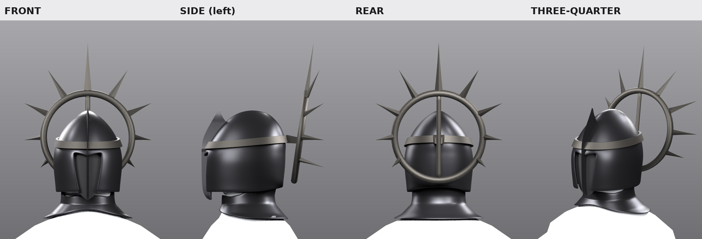

# Cavaliere3D — Wildshift Knight

Modelling project for a dark-fantasy knight character, built step by step in
Blender. Each step is a saved checkpoint (`.blend`) plus the script that
produced it, so every stage is reproducible and the earlier stages are never
disturbed.

## Checkpoints

| stage | file | content |
|---|---|---|
| 1 | `Wildshift_Knight_01.blend` | empty project: metric units, 1 unit = 1 m, origin/ground, studio lights, orthographic front/side/rear cameras, named collections, naming convention |
| 2 | `Wildshift_Knight_02_Proportions.blend` | measured proportion sheet, blockout mannequin, joint markers, silhouette/cape/weapon guides, reference views as aligned backdrops |
| 3 | `Wildshift_Knight_03_BaseBody.blend` | clean base body: one closed quad-dominant humanoid mesh (torso, pelvis, neck, head blank, arms, hands with thumbs, legs, feet), neutral material, proportion guide retained |
| 4 | `Wildshift_Knight_04_HelmetBlockout.blend` | helmet foundation and head silhouette: enclosed ogival helmet with a narrow recessed face, centre crest, neck guard, and a spiked halo crown of separate broad elements; dark placeholder materials, no rig |

## Prompt 2 — proportions

Deliverables:

* **`Wildshift_Knight_02_Proportions.blend`** — the proportioned blockout.
  * `Blockout` collection: `WSK_Mann_*`, 19 edit-friendly parts + a root empty.
    Each part is its own object with an identity transform, so a coordinate read
    in Edit mode *is* a world coordinate and X mirroring is exact.
  * `Reference` collection: `WSK_Joint_*` joint markers, `WSK_Guide_*`
    centreline / height ruler / silhouette / cape / weapon guides, `WSK_Label_*`
    ruler labels and `WSK_Ref_*` reference-view backdrops.
  * Text blocks `WSK_Proportion_Sheet.txt` (the sheet itself) and
    `WSK_Project_Notes.txt` (project conventions).
* **`analysis/diagram_front.png`, `analysis/diagram_side.png`** — annotated
  orthographic diagrams with the landmark heights and joint positions.
* **`analysis/reference_measurements.md`** — every reading taken off the
  reference, with its uncertainty.
* **`analysis/overlay_{front,back,side}.png`** — the rendered silhouette laid
  over the reference view at the calibrated scale.
* **`analysis/verify/verify_report.txt`** — 62 automated checks.

### Numbers

Body height 2.00 m ground → helmet dome (crown spikes add 0.11 m and are
guide-only). Shoulder joints at Z 1.63 (±0.20), hips at Z 1.00 (±0.10), knees
0.55, ankles 0.115. Upper arm 0.34 m, forearm 0.30 m, thigh 0.45 m, shank
0.44 m. Cape envelope 1.10 m wide, hem at Z 0.06, rear extent Y −0.72. Weapon
envelope 1.39 m long, crossguard 0.19 m, axis 0.36 m to the character's left.
Everything is marked *measured* or *assumed* in
`WSK_Proportion_Sheet.txt`, and lengths are ± 5 % at best (see the
uncertainties section of that text block).

## Prompt 3 — base body

Deliverable: **`Wildshift_Knight_03_BaseBody.blend`**

* `Body` collection — **`WSK_Body_Base_01`**, a single closed manifold mesh:
  1832 verts / 1838 faces, 96 % quads, V−E+F = 2, no loose or duplicate
  vertices, no self-intersections, only six n-gons (the tube-root caps).
* The Prompt 2 blockout and the whole proportion guide are **retained**:
  `Blockout` (`WSK_Mann_*`, 20 objects) is disabled in the viewport and in
  renders, `Reference` (`WSK_Joint_*`, `WSK_Guide_*`, `WSK_Label_*`,
  `WSK_Ref_*`) is still enabled and separate from the body.  Nothing was deleted.
* `Helmet`, `Armor`, `Cape`, `Accessories`, `Weapon` and `Rig` are still empty:
  no armour, helmet, cape, chains, weapon, rig or animation was created.
* Text blocks `WSK_BaseBody_Topology_Notes.txt` (the topology report below) and
  `WSK_Project_Notes.txt`.

### How the body is built

The torso/neck/head is a lofted **half shell** (rings of 17 verts from the
crotch to the crown). Where a limb attaches, a rectangular **patch of quads is
deleted and its boundary loop becomes the first ring of the limb tube**, so
every limb is continuous with the torso — no bridging, no overlapping shells,
no interior geometry. Ring angles are eased from the irregular cut boundary
onto an even spacing, and each ring's "front" axis is pinned to +Y so no tube
twists. The +X half is then mirrored with an applied Mirror modifier
(clip + 0.5 mm merge): left/right are exact and the centreline is welded.

Everything is in world space with an identity object transform, so a
coordinate read in Edit mode *is* a world coordinate — the same convention as
the Prompt 2 blockout.

### Numbers

Origin, orientation and scale are unchanged. Feet on Z = 0, crown (no helmet)
**1.910 m**, i.e. 0.09 m of shell clearance under the guide's 2.00 m helmet
dome — the 2.00 m envelope belongs to the helmet, not the bare skull. Torso
0.326 × 0.283 m at the armpit, 0.30 m at the waist, 0.344 × 0.26 m at the
pelvis, acromion 0.41 m wide so the guide's 0.46 m pauldron plate lands just
outside it. Every guide joint marker (shoulder, elbow, wrist, hip, knee,
ankle) is inside the body volume and every limb ring passes through its
marker; the markers themselves were not moved.

### Verification

* `analysis/basebody/check_body_*.png` — front, side, rear and three-quarter
  renders of the delivered body.
* `analysis/basebody/sheet_reference_overlay.png` — the body silhouette
  composited on the reference front/back/side at the reference's own mm/px
  calibration (anchored on the ground line, **not** rescaled to match the
  figure) — the proportion cross-check.
* `analysis/basebody/sheet_body_views.png`, `cl_*.png` — joint close-ups for
  shoulder, hip, knee, head, hand, foot.
* `analysis/verify/verify_base_body_report.txt` — **113 automated checks**
  (file scope, mesh quality, self-intersection, scale/origin/symmetry, guide
  proportions and joint alignment).

### Topology limitations to know before rigging

1. Elbows and knees are straight in the rest pose and there is no carrying
   angle on the arm chain. An IK rig wants a small forward offset on the
   elbow/knee bones, and the first bend may pinch on the inner side — there
   are three loops across each joint, which is the minimum. Add 1–2 more if a
   pose needs it.
2. There is **no clavicle topology**. The deltoid is part of the chest and
   deforms with it: fine for an FK arm, less good for a full shoulder rig.
3. Hands are **mitten blocks** (palm, knuckles, thumb): no finger or knuckle
   loops. Fingers are a separate, later decision.
4. The head is a cranium blank with no face/jaw/eye topology and the neck is
   short (Z 1.690–1.755). It exists to carry a helmet.
5. Vertex count is blockout density — enough for proportion and armour-fit
   checks, not for skin sliding.
6. The body is **bilaterally symmetric by construction**. The reference's
   asymmetric pose is recorded by the Prompt 2 empties `WSK_Guide_RefPose_*`
   and is deliberately not baked in; author any real asymmetry after this
   checkpoint.
7. Limbs attach by branch (5-sided) poles at the armpit and groin, and the
   crown/crotch/thumb/fingertip ends are triangle fans — normal for this
   construction, but they are the spots to watch if the mesh is ever
   subdivided hard.

## Prompt 4 — helmet base and head silhouette

Deliverable: **`Wildshift_Knight_04_HelmetBlockout.blend`** (built from
checkpoint 3, which is not modified).



* `Helmet` collection — moves with the head unless noted:
  * `WSK_Helmet_Root_01`: an empty on the guide neck joint (0, 0, 1.78). It is
    the parent of every part that turns with the head. Rotate it to preview a
    head turn; it is not a bone.
  * `WSK_Helmet_Shell_01`: the enclosed skull, with an ogival
    (two-centred, gothic-arch) dome, a soft medial ridge, cheek guards and a
    nape. A narrow face slot with a hard brow V is cut into the front.
  * `WSK_Helmet_Faceplate_01`: a near-black plate recessed behind the slot,
    with one shallow keel down to a pointed chin. It has no eyes, nose or mouth,
    so it reads as darkness, not a face.
  * `WSK_Helmet_Crest_01`: the centre fin. It runs chin → keel → brow → a free
    blade tip in front of the dome.
  * `WSK_Helmet_NeckGuard_01`: the gorget, shrink-fitted to the neck and
    trapezius. It is **not** parented to the head; it belongs to the torso.
* `Crown` collection, a child of `Helmet`. Every element is a separate object:
  * `WSK_Helmet_CrownBand_01`: the circlet round the brow, 1.5 mm off the
    shell.
  * `WSK_Helmet_CrownHalo_01`: a full ring **behind** the head, tilted back 8°.
    From the front it frames the upper head and its lower half hides behind
    the helmet, as in the reference front view. From behind, the whole ring and
    a central spine read, as in the reference back view.
  * `WSK_Helmet_CrownSpine_01` is the ring's vertical diameter.
    `WSK_Helmet_CrownMount_01` brackets it to the back of the band; this is
    what visibly carries the halo.
  * `WSK_Helmet_CrownSpike_{C,R1..R4,L1..L4}_01`: nine broad spikes at 0, ±30,
    ±60, ±90 and ±120°. Their reach falls off steadily from the top down. Each
    leans back out of the ring plane, 0° at the top to 70° at ±120°. In side
    view this gives the reference's backward fan instead of a flat disc.
* Three placeholder materials, Principled BSDF only, with no textures and no
  emission:
  * `MAT_Helmet_DarkSteel_01` (shell, crest, neck guard).
  * `MAT_Helmet_FaceVoid_01` (matte near-black).
  * `MAT_Helmet_CrownIron_01` (crown).
* No armature, bones, shape keys or facial rig. The body, guide, cameras and
  lights are unchanged, and the base body stays visible as the scale reference.
* Text block `WSK_Helmet_Blockout_Notes.txt`, plus a Prompt 4 section in
  `WSK_Project_Notes.txt`. That section corrects the Prompt 3 notes' crown
  height from 1.956 m to the real 1.910 m.

### How it is built

The shell, face plate and neck guard follow the same method as the body. Each
is a **+X half surface in world space**, with identity transforms and live
**Mirror → Solidify → Subdivision** modifiers. You edit a few hundred vertices
and both sides follow.
* **Shell:** lofted from horizontal sections, using a profile table of
  half-width, front/back extent, centre and superellipse exponents. Above
  Z 1.845 the front view is a two-centred arch closing on the apex. The face
  slot is one clean edge loop solved onto the designed outline.
* **Neck guard and crown band:** ray-fitted. The neck guard is fitted to the
  base body with 6 mm clearance at the top and 8 mm lower down. The band is
  fitted to the evaluated (subdivided) shell, and its +X half is mirrored
  exactly.
* **Crown pivots:** each crown piece has a meaningful pivot. The halo pivots
  on its centre; each spike pivots on its base with local +Z along the spike.
  Scaling a spike's local Z changes its length, and scaling the halo resizes
  the whole crown.

### Numbers

| | blockout | guide |
|---|---|---|
| helmet width / dome top / chin | 0.195 m / 1.995 / 1.740 | 0.19 / 2.00 / 1.74 |
| head clearance: shell / face plate / neck guard | 5.7 / 7.9 / 5.7 mm | — |
| halo outer width | 0.269 m (−3.9 %) | 0.28 |
| spike span / ±30° tips | ±0.180 m / Z 2.110 | ±0.18 / 2.11 |
| central spike tip | Z 2.187 | 2.11 ("guide only / not measured") |
| helmet front / lowest point | Y 0.139 / Z 1.740 | head front 0.132 |

Deliberate deviations, also listed in the notes and the verification report:
* **Helmet width.** It is 0.195 m, because the Prompt 3 skull is 0.172 m wide.
  Adding 5 mm of clearance and a 5 mm wall on each side needs 0.192 m. The
  reference's hooded head reads slimmer, and the hood (Cape step) will hang
  close at the jaw.
* **Central spike.** It is the tallest element in the reference and continues
  the crest line. Scale `WSK_Helmet_CrownSpike_C_01` to about 0.47 in local Z
  to sit it on 2.11 m.
* **Lower spikes.** They sweep back rather than down, with their lowest tips
  at Z 1.833 against the guide frame's 1.76. That keeps them clear of the
  pauldrons to come.

### Rig readiness

Nothing was rigged. The rig check is numeric:
* **Moving part:** the whole head assembly (helmet and crown) is rotated.
* **Static parts:** the torso below Z 1.69 and the neck guard.
* **Head bone:** pivots on the guide neck joint (0, 0, 1.78).
* **Neck bone:** pivots on the neck-base ring (0, 0.004, 1.69).

All of these clear with at least 3.6 mm:
* **Head bone alone:** flexion 15°, extension 20°, turn ±60°, tilt ±10°, plus
  combinations.
* **Neck + head:** look down 30°, look up 45°, tilt 30°, look over the shoulder
  80°, plus diagonals.

First contact happens at:
* **Head bone:** chin-down 27.8°, look-up 33.0°, tilt 18.9°, turn beyond 90°.
* **Neck bone:** 40.8°, 58.8°, 36.8° and beyond 60° respectively.
* **Chained look-down:** about 40°, when the helmet chin meets the neck guard
  and upper chest. That is expected for a closed helmet whose chin sits ~4 cm
  ahead of the throat.

The neck guard is static in this test, which is the worst case. A rigged
gorget weighted partly to the neck bone gains more range.

### Verification

`tools/verify_helmet_blockout.py` runs **68 automated checks**. All geometry
is checked on the evaluated meshes.
* **Scope:** checkpoints 1–3 are untouched, and the body, guide and other
  collections are unchanged.
* **Objects and materials:** naming, hierarchy, separate mesh datablocks,
  dark non-emissive materials, and no rig.
* **Mesh integrity:** every part is closed and manifold, with outward normals
  and no self-intersections.
* **Symmetry and balance:** X symmetry, plus crown balance by centre of mass
  and by front-silhouette area.
* **Contacts:** the 136 part pairs show only the intended contacts, and every
  joint is really connected.
* **Fit:** the head is fully enclosed (from the front, back, sides and top);
  the face plate is featureless; there are no see-through holes at render
  subdivision.
* **Guide and rig:** dimensions against the guide, and the pose sweep above.

Outputs:
* `analysis/verify/verify_helmet_report.txt` — the full report.
* `analysis/helmet/helmet_{front,side_left,side_right,rear,threequarter,threequarter_rear}.png`
  — Cycles views on a light backdrop. The world is kept dark so the dark
  metals reflect darkness.
* `analysis/helmet/helmet_silhouettes.png` — front, side and rear masks.
* `analysis/helmet/helmet_vs_reference.png` — reference head crops above the
  blockout at the same metric framing.
* `analysis/helmet/helmet_section_{sagittal,coronal,transverse}.png` — slices
  through body, shell, plate, crest, neck guard and crown.
* `analysis/helmet/helmet_rig_poses.png` — rest, flexion, extension, turn
  and tilt, rendered with a temporary head/torso split of the body.

## Reproducing

```bash
tools/setup_headless_blender.sh        # once: venv + bpy + generated GL stubs
tools/bl.sh tools/build_proportions.py        # writes checkpoint 2
tools/bl.sh tools/verify_proportions.py       # 62 checks + silhouette renders
tools/bl.sh tools/render_progress_checks.py   # orthographic progress renders
tools/bl.sh tools/make_proportion_diagram.py  # annotated diagrams
tools/bl.sh tools/build_base_body.py          # writes checkpoint 3
tools/bl.sh tools/verify_base_body.py         # 113 checks + views + overlays
tools/bl.sh tools/build_helmet_blockout.py    # writes checkpoint 4
tools/bl.sh tools/verify_helmet_blockout.py   # 68 checks + views, sections, poses
#   WSK_SKIP_RENDERS=1 for the numeric checks only, WSK_SAMPLES=<n> for render quality
```

This sandbox has no Blender install and no X11/OpenGL/EGL runtime, so Blender is
used as the official `bpy` Python module (4.5.0) with tiny generated stub
libraries standing in for the missing GL/X11 sonames. Headless scene editing,
the Python API and Cycles CPU rendering all work that way; EEVEE and any OpenGL
viewport feature do not, which is why every render here uses Cycles on CPU.
The stub generator also emits a loadable placeholder for sonames that are
needed without any referenced symbol (`libXrender.so.1` on some bpy builds).

## Repository layout

```
reference/                 the supplied reference images (inputs)
analysis/                  measurements, diagrams, verification (outputs)
analysis/basebody/         Prompt 3 body renders, joint close-ups, overlays
analysis/helmet/           Prompt 4 helmet views, silhouettes, sections, poses
tools/                     build, verification and measurement scripts
tools/bl.sh                run a script with the headless Blender
tools/build_proportions.py checkpoint 2: proportion sheet + blockout
tools/build_base_body.py   checkpoint 3: the base body
tools/build_helmet_blockout.py   checkpoint 4: helmet + crown blockout
tools/verify_*.py          the check suites (proportions, base body, helmet)
Wildshift_Knight_0*.blend  checkpoints
setup_blend.py             checkpoint 1 script
```
