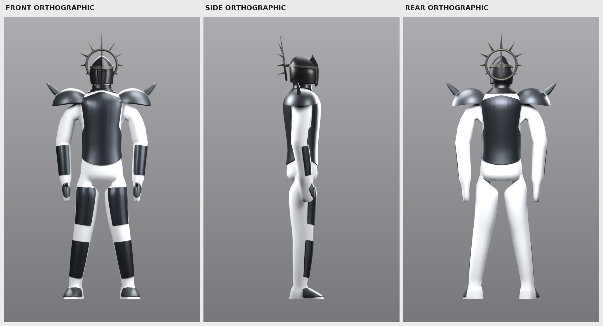
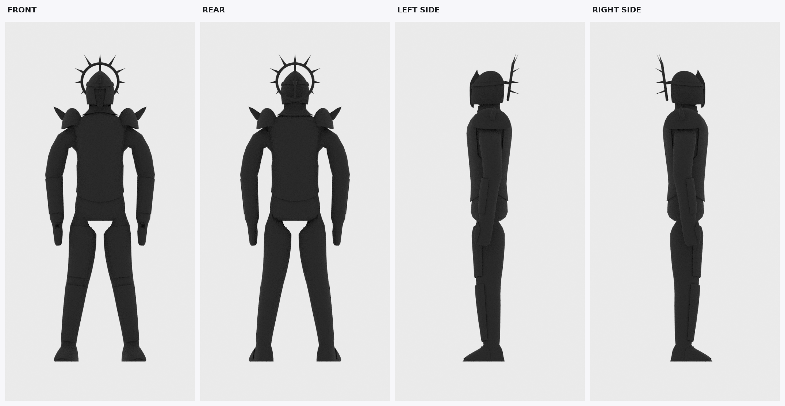
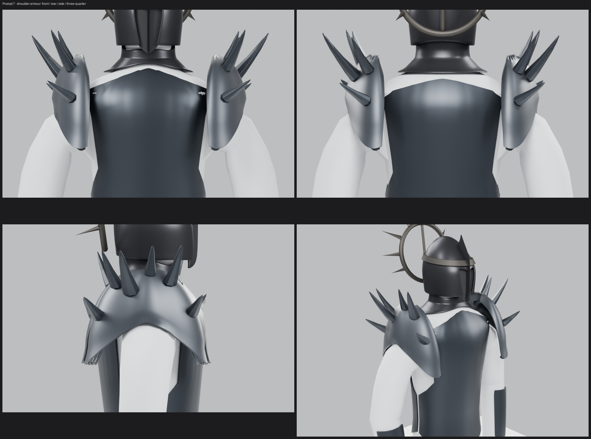
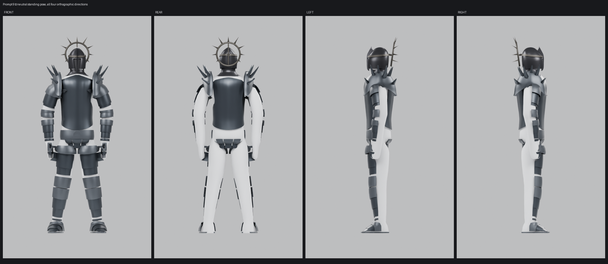
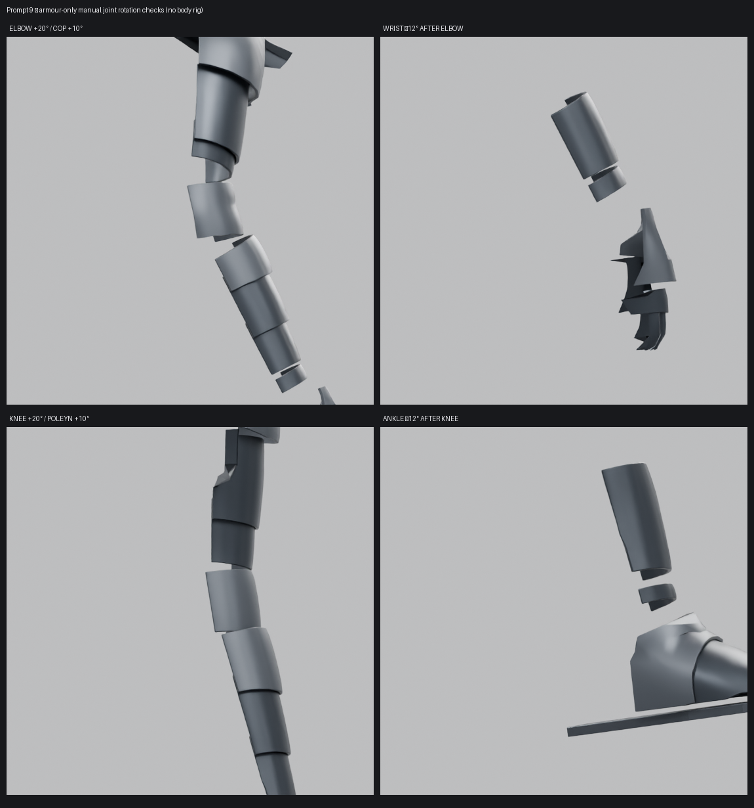
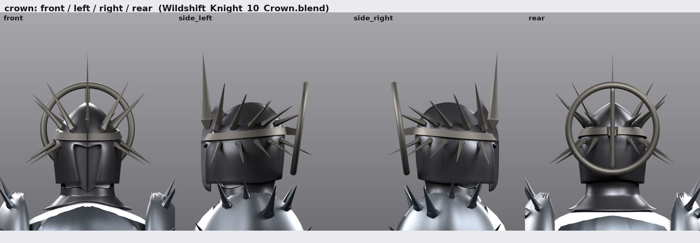

# Cavaliere3D — Wildshift Knight

Modelling project for a dark-fantasy knight character, built step by step in
Blender. Each step is a saved checkpoint (`.blend`) plus the script that
produced it, so every stage is reproducible and the earlier stages are never
disturbed.

## Checkpoints

| stage | file | content |
|---|---|---|
| 1 | `Wildshift_Knight_01.blend` | empty project: metric units, 1 unit = 1 m, origin/ground, studio lights, orthographic front/side/rear cameras, named collections, naming convention |
| 2 | `Wildshift_Knight_02_Proportions.blend` | measured proportion sheet, blockout mannequin, joint markers, silhouette/cape/weapon guides, reference views as aligned backdrops |
| 3 | `Wildshift_Knight_03_BaseBody.blend` | clean base body: one closed quad-dominant humanoid mesh (torso, pelvis, neck, head blank, arms, hands with thumbs, legs, feet), neutral material, proportion guide retained |
| 4 | `Wildshift_Knight_04_HelmetBlockout.blend` | helmet foundation and head silhouette: enclosed ogival helmet with a narrow recessed face, centre crest, neck guard, and a spiked halo crown of separate broad elements; dark placeholder materials, no rig |
| 5 | `Wildshift_Knight_05_ArmorBlockout.blend` | major armor masses in sixteen separate, editable pieces: cuirass front/back, broad pauldrons with two separate spikes, forearm and hand placeholders, thigh/shin guards, and sabatons; dark untextured placeholder metals, no rig |
| 6 | `Wildshift_Knight_06_Silhouette.blend` | whole-figure silhouette pass: pauldrons narrowed to 0.530 m of plate, the two shoulder spikes re-seated as one broad 45 deg spike each on a 0.640 m span, central crown spike shortened to Z 2.115, leg guards extended toward knee and ankle, gauntlets over the fingertips, sabatons on the ground plane, plus a temporary silhouette material, world, view layer and four orthographic inspection cameras |
| 7 | `Wildshift_Knight_07_Shoulders.blend` | layered gothic shoulders: four closed plates and six separate graded spikes per side, manual shoulder pivots and articulation checks |
| 8 | `Wildshift_Knight_08_TorsoArmor.blend` | refined chest/back cuirass, separate side plates, waist belt, hanging waist panels and blank medallion mount |
| 9 | `Wildshift_Knight_09_LimbArmor.blend` | 54 separate refined limb-armour meshes: layered upper arms, forearms, gauntlets, thighs, greaves and sabatons; visibly segmented joints, stable soles, manual pose pivots and attachment metadata; no rig |
| 10 | `Wildshift_Knight_10_Crown.blend` | thorn crown: the nine flat radial spikes replaced by 21 planted thorns in two graded rows around the existing halo ring, and the twelve shoulder spikes re-cut in the same profile at 65 % length; every base ray-planted on the evaluated helmet and length-fitted against all other parts |
| 11 | `Wildshift_Knight_11_Medallion.blend` | waist medallion: the blank mount checkpoint 8 deferred now carries a restrained antique-gold ornament - a slightly irregular gold ring, a dark recessed centre and 16 fitted radial blades at 77 mm across, plus the same design at 88 % on the lower back plate; every part seated on the measured armour surface |

## Prompt 2 — proportions

Deliverables:

* **`Wildshift_Knight_02_Proportions.blend`** — the proportioned blockout.
  * `Blockout` collection: `WSK_Mann_*`, 19 edit-friendly parts + a root empty.
    Each part is its own object with an identity transform, so a coordinate read
    in Edit mode *is* a world coordinate and X mirroring is exact.
  * `Reference` collection: `WSK_Joint_*` joint markers, `WSK_Guide_*`
    centreline / height ruler / silhouette / cape / weapon guides, `WSK_Label_*`
    ruler labels and `WSK_Ref_*` reference-view backdrops.
  * Text blocks `WSK_Proportion_Sheet.txt` (the sheet itself) and
    `WSK_Project_Notes.txt` (project conventions).
* **`analysis/diagram_front.png`, `analysis/diagram_side.png`** — annotated
  orthographic diagrams with the landmark heights and joint positions.
* **`analysis/reference_measurements.md`** — every reading taken off the
  reference, with its uncertainty.
* **`analysis/overlay_{front,back,side}.png`** — the rendered silhouette laid
  over the reference view at the calibrated scale.
* **`analysis/verify/verify_report.txt`** — 62 automated checks.

### Numbers

Body height 2.00 m ground → helmet dome (crown spikes add 0.11 m and are
guide-only). Shoulder joints at Z 1.63 (±0.20), hips at Z 1.00 (±0.10), knees
0.55, ankles 0.115. Upper arm 0.34 m, forearm 0.30 m, thigh 0.45 m, shank
0.44 m. Cape envelope 1.10 m wide, hem at Z 0.06, rear extent Y −0.72. Weapon
envelope 1.39 m long, crossguard 0.19 m, axis 0.36 m to the character's left.
Everything is marked *measured* or *assumed* in
`WSK_Proportion_Sheet.txt`, and lengths are ± 5 % at best (see the
uncertainties section of that text block).

## Prompt 3 — base body

Deliverable: **`Wildshift_Knight_03_BaseBody.blend`**

* `Body` collection — **`WSK_Body_Base_01`**, a single closed manifold mesh:
  1832 verts / 1838 faces, 96 % quads, V−E+F = 2, no loose or duplicate
  vertices, no self-intersections, only six n-gons (the tube-root caps).
* The Prompt 2 blockout and the whole proportion guide are **retained**:
  `Blockout` (`WSK_Mann_*`, 20 objects) is disabled in the viewport and in
  renders, `Reference` (`WSK_Joint_*`, `WSK_Guide_*`, `WSK_Label_*`,
  `WSK_Ref_*`) is still enabled and separate from the body.  Nothing was deleted.
* `Helmet`, `Armor`, `Cape`, `Accessories`, `Weapon` and `Rig` are still empty:
  no armour, helmet, cape, chains, weapon, rig or animation was created.
* Text blocks `WSK_BaseBody_Topology_Notes.txt` (the topology report below) and
  `WSK_Project_Notes.txt`.

### How the body is built

The torso/neck/head is a lofted **half shell** (rings of 17 verts from the
crotch to the crown). Where a limb attaches, a rectangular **patch of quads is
deleted and its boundary loop becomes the first ring of the limb tube**, so
every limb is continuous with the torso — no bridging, no overlapping shells,
no interior geometry. Ring angles are eased from the irregular cut boundary
onto an even spacing, and each ring's "front" axis is pinned to +Y so no tube
twists. The +X half is then mirrored with an applied Mirror modifier
(clip + 0.5 mm merge): left/right are exact and the centreline is welded.

Everything is in world space with an identity object transform, so a
coordinate read in Edit mode *is* a world coordinate — the same convention as
the Prompt 2 blockout.

### Numbers

Origin, orientation and scale are unchanged. Feet on Z = 0, crown (no helmet)
**1.910 m**, i.e. 0.09 m of shell clearance under the guide's 2.00 m helmet
dome — the 2.00 m envelope belongs to the helmet, not the bare skull. Torso
0.326 × 0.283 m at the armpit, 0.30 m at the waist, 0.344 × 0.26 m at the
pelvis, acromion 0.41 m wide so the guide's 0.46 m pauldron plate lands just
outside it. Every guide joint marker (shoulder, elbow, wrist, hip, knee,
ankle) is inside the body volume and every limb ring passes through its
marker; the markers themselves were not moved.

### Verification

* `analysis/basebody/check_body_*.png` — front, side, rear and three-quarter
  renders of the delivered body.
* `analysis/basebody/sheet_reference_overlay.png` — the body silhouette
  composited on the reference front/back/side at the reference's own mm/px
  calibration (anchored on the ground line, **not** rescaled to match the
  figure) — the proportion cross-check.
* `analysis/basebody/sheet_body_views.png`, `cl_*.png` — joint close-ups for
  shoulder, hip, knee, head, hand, foot.
* `analysis/verify/verify_base_body_report.txt` — **113 automated checks**
  (file scope, mesh quality, self-intersection, scale/origin/symmetry, guide
  proportions and joint alignment).

### Topology limitations to know before rigging

1. Elbows and knees are straight in the rest pose and there is no carrying
   angle on the arm chain. An IK rig wants a small forward offset on the
   elbow/knee bones, and the first bend may pinch on the inner side — there
   are three loops across each joint, which is the minimum. Add 1–2 more if a
   pose needs it.
2. There is **no clavicle topology**. The deltoid is part of the chest and
   deforms with it: fine for an FK arm, less good for a full shoulder rig.
3. Hands are **mitten blocks** (palm, knuckles, thumb): no finger or knuckle
   loops. Fingers are a separate, later decision.
4. The head is a cranium blank with no face/jaw/eye topology and the neck is
   short (Z 1.690–1.755). It exists to carry a helmet.
5. Vertex count is blockout density — enough for proportion and armour-fit
   checks, not for skin sliding.
6. The body is **bilaterally symmetric by construction**. The reference's
   asymmetric pose is recorded by the Prompt 2 empties `WSK_Guide_RefPose_*`
   and is deliberately not baked in; author any real asymmetry after this
   checkpoint.
7. Limbs attach by branch (5-sided) poles at the armpit and groin, and the
   crown/crotch/thumb/fingertip ends are triangle fans — normal for this
   construction, but they are the spots to watch if the mesh is ever
   subdivided hard.

## Prompt 4 — helmet base and head silhouette

Deliverable: **`Wildshift_Knight_04_HelmetBlockout.blend`** (built from
checkpoint 3, which is not modified).


* `Helmet` collection — moves with the head unless noted:
  * `WSK_Helmet_Root_01`: an empty on the guide neck joint (0, 0, 1.78). It is
    the parent of every part that turns with the head. Rotate it to preview a
    head turn; it is not a bone.
  * `WSK_Helmet_Shell_01`: the enclosed skull, with an ogival
    (two-centred, gothic-arch) dome, a soft medial ridge, cheek guards and a
    nape. A narrow face slot with a hard brow V is cut into the front.
  * `WSK_Helmet_Faceplate_01`: a near-black plate recessed behind the slot,
    with one shallow keel down to a pointed chin. It has no eyes, nose or mouth,
    so it reads as darkness, not a face.
  * `WSK_Helmet_Crest_01`: the centre fin. It runs chin → keel → brow → a free
    blade tip in front of the dome.
  * `WSK_Helmet_NeckGuard_01`: the gorget, shrink-fitted to the neck and
    trapezius. It is **not** parented to the head; it belongs to the torso.
* `Crown` collection, a child of `Helmet`. Every element is a separate object:
  * `WSK_Helmet_CrownBand_01`: the circlet round the brow, 1.5 mm off the
    shell.
  * `WSK_Helmet_CrownHalo_01`: a full ring **behind** the head, tilted back 8°.
    From the front it frames the upper head and its lower half hides behind
    the helmet, as in the reference front view. From behind, the whole ring and
    a central spine read, as in the reference back view.
  * `WSK_Helmet_CrownSpine_01` is the ring's vertical diameter.
    `WSK_Helmet_CrownMount_01` brackets it to the back of the band; this is
    what visibly carries the halo.
  * `WSK_Helmet_CrownSpike_{C,R1..R4,L1..L4}_01`: nine broad spikes at 0, ±30,
    ±60, ±90 and ±120°. Their reach falls off steadily from the top down. Each
    leans back out of the ring plane, 0° at the top to 70° at ±120°. In side
    view this gives the reference's backward fan instead of a flat disc.
* Three placeholder materials, Principled BSDF only, with no textures and no
  emission:
  * `MAT_Helmet_DarkSteel_01` (shell, crest, neck guard).
  * `MAT_Helmet_FaceVoid_01` (matte near-black).
  * `MAT_Helmet_CrownIron_01` (crown).
* No armature, bones, shape keys or facial rig. The body, guide, cameras and
  lights are unchanged, and the base body stays visible as the scale reference.
* Text block `WSK_Helmet_Blockout_Notes.txt`, plus a Prompt 4 section in
  `WSK_Project_Notes.txt`. That section corrects the Prompt 3 notes' crown
  height from 1.956 m to the real 1.910 m.

### How it is built

The shell, face plate and neck guard follow the same method as the body. Each
is a **+X half surface in world space**, with identity transforms and live
**Mirror → Solidify → Subdivision** modifiers. You edit a few hundred vertices
and both sides follow.
* **Shell:** lofted from horizontal sections, using a profile table of
  half-width, front/back extent, centre and superellipse exponents. Above
  Z 1.845 the front view is a two-centred arch closing on the apex. The face
  slot is one clean edge loop solved onto the designed outline.
* **Neck guard and crown band:** ray-fitted. The neck guard is fitted to the
  base body with 6 mm clearance at the top and 8 mm lower down. The band is
  fitted to the evaluated (subdivided) shell, and its +X half is mirrored
  exactly.
* **Crown pivots:** each crown piece has a meaningful pivot. The halo pivots
  on its centre; each spike pivots on its base with local +Z along the spike.
  Scaling a spike's local Z changes its length, and scaling the halo resizes
  the whole crown.

### Numbers

| | blockout | guide |
|---|---|---|
| helmet width / dome top / chin | 0.195 m / 1.995 / 1.740 | 0.19 / 2.00 / 1.74 |
| head clearance: shell / face plate / neck guard | 5.7 / 7.9 / 5.7 mm | — |
| halo outer width | 0.269 m (−3.9 %) | 0.28 |
| spike span / ±30° tips | ±0.180 m / Z 2.110 | ±0.18 / 2.11 |
| central spike tip | Z 2.187 | 2.11 ("guide only / not measured") |
| helmet front / lowest point | Y 0.139 / Z 1.740 | head front 0.132 |

Deliberate deviations, also listed in the notes and the verification report:
* **Helmet width.** It is 0.195 m, because the Prompt 3 skull is 0.172 m wide.
  Adding 5 mm of clearance and a 5 mm wall on each side needs 0.192 m. The
  reference's hooded head reads slimmer, and the hood (Cape step) will hang
  close at the jaw.
* **Central spike.** It is the tallest element in the reference and continues
  the crest line. Scale `WSK_Helmet_CrownSpike_C_01` to about 0.47 in local Z
  to sit it on 2.11 m.
* **Lower spikes.** They sweep back rather than down, with their lowest tips
  at Z 1.833 against the guide frame's 1.76. That keeps them clear of the
  pauldrons to come.

### Rig readiness

Nothing was rigged. The rig check is numeric:
* **Moving part:** the whole head assembly (helmet and crown) is rotated.
* **Static parts:** the torso below Z 1.69 and the neck guard.
* **Head bone:** pivots on the guide neck joint (0, 0, 1.78).
* **Neck bone:** pivots on the neck-base ring (0, 0.004, 1.69).

All of these clear with at least 3.6 mm:
* **Head bone alone:** flexion 15°, extension 20°, turn ±60°, tilt ±10°, plus
  combinations.
* **Neck + head:** look down 30°, look up 45°, tilt 30°, look over the shoulder
  80°, plus diagonals.

First contact happens at:
* **Head bone:** chin-down 27.8°, look-up 33.0°, tilt 18.9°, turn beyond 90°.
* **Neck bone:** 40.8°, 58.8°, 36.8° and beyond 60° respectively.
* **Chained look-down:** about 40°, when the helmet chin meets the neck guard
  and upper chest. That is expected for a closed helmet whose chin sits ~4 cm
  ahead of the throat.

The neck guard is static in this test, which is the worst case. A rigged
gorget weighted partly to the neck bone gains more range.

### Verification

`tools/verify_helmet_blockout.py` runs **68 automated checks**. All geometry
is checked on the evaluated meshes.
* **Scope:** checkpoints 1–3 are untouched, and the body, guide and other
  collections are unchanged.
* **Objects and materials:** naming, hierarchy, separate mesh datablocks,
  dark non-emissive materials, and no rig.
* **Mesh integrity:** every part is closed and manifold, with outward normals
  and no self-intersections.
* **Symmetry and balance:** X symmetry, plus crown balance by centre of mass
  and by front-silhouette area.
* **Contacts:** the 136 part pairs show only the intended contacts, and every
  joint is really connected.
* **Fit:** the head is fully enclosed (from the front, back, sides and top);
  the face plate is featureless; there are no see-through holes at render
  subdivision.
* **Guide and rig:** dimensions against the guide, and the pose sweep above.

Outputs:
* `analysis/verify/verify_helmet_report.txt` — the full report.
* `analysis/helmet/helmet_{front,side_left,side_right,rear,threequarter,threequarter_rear}.png`
  — Cycles views on a light backdrop. The world is kept dark so the dark
  metals reflect darkness.
* `analysis/helmet/helmet_silhouettes.png` — front, side and rear masks.
* `analysis/helmet/helmet_vs_reference.png` — reference head crops above the
  blockout at the same metric framing.
* `analysis/helmet/helmet_section_{sagittal,coronal,transverse}.png` — slices
  through body, shell, plate, crest, neck guard and crown.
* `analysis/helmet/helmet_rig_poses.png` — rest, flexion, extension, turn
  and tilt, rendered with a temporary head/torso split of the body.

## Prompt 5 — major armor plates

Deliverable: **`Wildshift_Knight_05_ArmorBlockout.blend`**, built from
checkpoint 4. The base body and helmet/crown are unchanged. The existing
`Armor` collection now contains **16 independent, closed mesh objects**; no
armor is joined, parented to a rig, or otherwise made rigid as one shell.



* `WSK_Armor_Chest_01` and `WSK_Armor_Back_01` are separate wraparound
  cuirass shells. Their side seam remains separate, and the upper edges tuck
  inward under the pauldrons to leave the armpit/shoulder articulation readable.
* `WSK_Armor_Pauldron_{R,L}_01` are broad, balanced domed caps. Each has one
  **separate** broad shoulder spike (`WSK_Armor_ShoulderSpike_{R,L}_01`), two
  spikes total. The shoulder span is 0.906 m; the tips remain below the helmet
  crown spikes.
* `WSK_Armor_Forearm_{R,L}_01`, `WSK_Armor_Thigh_{R,L}_01`, and
  `WSK_Armor_Shin_{R,L}_01` are individual swept plates, not continuous limb
  shells. `WSK_Armor_Gauntlet_{R,L}_01` and `WSK_Armor_Sabaton_{R,L}_01` are
  simple hand and foot armor placeholders.
* Two untextured Principled placeholder materials provide the dark contrast:
  `MAT_Armor_BlackenedSteel_01` and `MAT_Armor_BroadIron_01`. There are no
  chains, filigree, cloth, weapon, final textures, or rig.
* Objects carry attachment-hint metadata only; nothing is parented to bones.
  The helmet, body, guide, cameras, lights and all earlier collections remain
  as they were in checkpoint 4.

### Articulation and reshape notes

The rest-pose check keeps the elbow and wrist markers 68.0 mm and 55.9 mm
from armor, respectively; hip, knee and ankle markers are 124.0 mm, 100.3 mm
and 69.7 mm away. These are static clearances, not a pose sweep—the character
is deliberately not rigged yet.

Pieces still needing a rig-fit pass:

1. **Pauldrons:** check the inner underside against the gorget and upper arm
   during shoulder lift/rotation; adjust the shell edge if it catches.
2. **Forearm guards:** test the separate bracers through elbow and wrist bends.
   Their rest-pose gaps are visible, but there is no articulation test yet.
3. **Thigh and shin guards:** re-fit their offsets/ends after the hip and knee
   pivots are finalized.
4. **Sabatons:** refine the toe/ankle transition and sole clearance after the
   foot pivot is defined; these remain broad placeholders.
5. **Gauntlets:** resize or split only after the hand/finger design is settled.

The chest and back fit the neutral body and remain separate; no immediate
reshaping is required for the blockout. Each pauldron intentionally laps the
upper outer edges of the chest and back, creating a shallow layered shoulder
seam. The spikes remain separate meshes; no deep spike/pauldron penetration
is needed to hold their visual placement.

### Verification

`tools/verify_armor_blockout.py` runs **43 automated checks** on evaluated
meshes and renders the required front, side and rear orthographic views.
It confirms the body and helmet are preserved, every armor object is its own
closed manifold shell, bilateral parts are balanced, and no unintended armor
plate intersections are present. `analysis/verify/verify_armor_report.txt`
contains the full results and closest-point articulation clearances.

Outputs:
* `analysis/armor/armor_views_orthographic.png` — labeled front, side and rear
  orthographic checks.
* `analysis/armor/armor_{front,side,rear}_ortho.png` — individual views.
* `analysis/verify/verify_armor_report.txt` — inventory, topology, balance,
  body fit, joint clearances and intended contacts.
* `WSK_Armor_Blockout_Notes.txt` — design and fitting notes saved inside the
  `.blend` file.

## Prompt 6 — full character silhouette

Deliverable: **`Wildshift_Knight_06_Silhouette.blend`**, built from checkpoint 5.
Scale, orientation and unit system are unchanged; the base body, the helmet
shell / face plate / crest / neck guard and twelve of the thirteen crown
elements are byte-identical.



### The one big correction: the shoulders

`analysis/reference_measurements.md` anchors the body height at
2.00 m = 81.2 % of 1293 px = 1050 px (**1.905 mm/px**) but converts its width
readings with "1 % of image width = 13.7 mm" (**1.615 mm/px**).  Those two
scales disagree by 17.9 %, so every width in that document is about 15 % short
of the figure it describes.  The Prompt 3 overlay (`verify_base_body.py`)
already used `m_per_px = 2.0 / body_px` = 1.905 mm/px, so Prompt 6 re-derives
every width with that single scale.

Width / height **ratios** are calibration free and are what decided the change:

| feature | raw reading | / body height | metres at 2.00 m | document said |
|---|---|---|---|---|
| pauldron plate outer edges | x 33.0 – 67.0 % | 0.275 | 0.549 m | 0.46 |
| spiked shoulder extent, front | x 30.5 – 69.5 % | 0.315 | 0.630 m | 0.52 – 0.54 |
| spiked shoulder extent, rear | x 30.0 – 74.0 % | 0.358 | 0.715 m | 0.61 |
| helmet / hood width | x 44.5 – 58.0 % | 0.109 | 0.218 m | 0.19 |
| crown ring outer span | x 40.0 – 60.5 % | 0.166 | 0.331 m | 0.28 |

Checkpoint 5's shoulders were 0.806 m of plate and 0.906 m over the spikes —
1.65× too wide for its own head.  Checkpoint 6 is **0.530 m of plate and
0.637 m over the spikes**, which puts the head-to-shoulder ratio at 0.31
against a reference of 0.35.

### Approved proportions

| feature | model | reference |
|---|---|---|
| helmet dome top (ground Z = 0) | 1.995 m | 2.000 |
| crown spike tips | 2.115 m | 2.131 |
| shoulder line / pauldron top edge | Z 1.740 | 1.744 |
| pauldron plate span | 0.530 m | 0.549 |
| spiked shoulder span | 0.637 m | 0.630 / 0.715 |
| shoulder spike | one per side, 0.113 m long, 45° out / 10° back | — |
| crown spike fan span | 0.361 m | 0.331 (ring) |
| chest / back plate outer edges | ±0.172 m | — |
| hip / knee / ankle | Z 1.000 / 0.550 / 0.115 | — |
| foot centres | ±0.236 m, stance 0.472 m | ±0.255, 0.510 |
| sabaton sole / cuff | Z 0.000 / 0.106 | 0.017 / 0.15 |

### Silhouette inspection setup (temporary, removable)

* `MAT_Silhouette_Dark_01` — flat near-black diffuse placeholder.
* `WSK_World_Silhouette` — flat light-grey contrasting backdrop.
* View layer **`Silhouette Check`** — `material_override` + `world_override`,
  with `Reference`, `Blockout` and `Lighting and Cameras` excluded.  Switch to
  it to see the outline; switch back to `ViewLayer` for normal work.
* `WSK_Cam_Sil_{Front,Rear,Left,Right}_01` — orthographic, 2.60 m, centred on
  Z 1.03, in a new `Silhouette Check` collection.

Nothing was merged, joined, applied or rigged: 16 armour objects each keep
their own mesh and their BEVEL modifier, and the crown is still 13 parts.

### Remaining visual issues

1. **Head is narrow.** Helmet 0.195 m vs a reference 0.218 m and crown ring
   0.269 m vs 0.331 m — a Prompt 4 deviation (helmet sized off the 0.172 m
   Prompt 3 skull).  Fix it with the hood, not by rescaling the crown.
2. **Stance** 0.472 m vs 0.510 m.  The legs are the Prompt 3 body.
3. **Chest depth** 0.314 m vs a side-view read of 0.368 m (~15 % shallow).
4. **Feet are long:** heel Y −0.114 vs a reference read of −0.050.
5. **Upper arms are unarmoured** between pauldron and bracer; no new part was
   added in Prompt 6.
6. **Arm pose** is the symmetric Prompt 3 rest pose.  The reference is
   asymmetric (one hand on a sword grip at about X 0.44, Z 1.45) — pose it
   after the rig.
7. **No cape yet.**  It dominates the reference outline below the shoulders
   (0.94 m wide, hem at Z 0.21) and will change the silhouette again.

### Verification

`tools/verify_silhouette.py` runs **57 automated checks**, all passing.  It
confirms the checkpoint-5 scope (only the 13 intended objects changed, only 4
cameras, one material, one world and one collection added), the approved
proportions, closed manifold shells, X balance, ground contact and upright
posture, crown / shoulder-spike separation, that armour overlaps are still
limited to the intended pauldron lap and the two spike seats, and that the four
inspection views agree on the same figure (height, width, depth, front/rear and
left/right mirror IoU above 0.99, one continuous mass in every view).

Outputs:
* `analysis/silhouette/silhouette_inspection.png` — front, rear, left and
  right inspection views on the contrasting backdrop.
* `analysis/silhouette/silhouette_{front,rear,left,right}.png` — the four
  views individually.
* `analysis/silhouette/silhouette_targets_{front,left}.png` — the same views
  with the approved landmark lines drawn on them.
* `analysis/silhouette/silhouette_before_after.png` — checkpoint 5 (red) vs
  checkpoint 6 (blue) front outlines.
* `analysis/verify/verify_silhouette_report.txt` — the full report.
* `analysis/reference_silhouette_targets.md` — the re-derived reference table
  and the measured silhouette profile.
* `WSK_Silhouette_Notes.txt` — the same approved proportions and issues, saved
  inside the `.blend` file.

## Prompt 7 — layered gothic shoulder armour

Deliverable: **`Wildshift_Knight_07_Shoulders.blend`**, built from checkpoint 6
(read only).  Scale, orientation and unit system are unchanged, and every object
outside the two shoulder assemblies — body, cuirass, back plate, forearms,
gauntlets, legs, sabatons, helmet shell, face plate, crest, gorget and all
thirteen crown elements — is byte-identical.



### What was there before

Checkpoint 6 gave each shoulder one broad domed shell and one spike.  The shell
was a single smooth cap that floated over the deltoid: nothing about it said
"plate armour", there was no hierarchy and no overlap to read.  Prompt 7 keeps
its approved outer dimensions and rebuilds it as a layered assembly.

### The assembly (10 objects per shoulder, 20 in total)

| object | role | samples | layer | body standoff |
|---|---|---|---|---|
| `WSK_Armor_Pauldron_{R,L}_01` | large primary plate | 16 × 37 | 0 | 5.2 / 9.8–107 mm |
| `WSK_Armor_PauldronLame1_{R,L}_01` | upper lame | 8 × 33 | 9 mm in | 19.5–101 mm |
| `WSK_Armor_PauldronLame2_{R,L}_01` | middle lame | 7 × 29 | 18 mm in | 17–93 mm |
| `WSK_Armor_PauldronLame3_{R,L}_01` | lower lame | 7 × 25 | 27 mm in | 19–86 mm |
| `WSK_Armor_ShoulderSpike_{R,L}_01` | primary spike | 8-sided | — | 0.153 m |
| `WSK_Armor_ShoulderSpikeFront_{R,L}_01` | front spike | 8-sided | — | 0.131 m |
| `WSK_Armor_ShoulderSpikeRear_{R,L}_01` | rear spike | 8-sided | — | 0.122 m |
| `WSK_Armor_ShoulderSpikeCrown_{R,L}_01` | crown spike | 8-sided | — | 0.092 m |
| `WSK_Armor_ShoulderSpikeFrontLow_{R,L}_01` | lower front barb | 8-sided | — | 0.092 m |
| `WSK_Armor_ShoulderSpikeRearLow_{R,L}_01` | lower rear barb | 8-sided | — | 0.103 m |

Each plate is a separate closed two-skin shell with its own mesh, its own BEVEL
modifier and one placeholder material; each spike is a separate closed tapered
shell.  Everything of one shoulder is parented to the empty
`WSK_Shoulder_Root_{R,L}_01` sitting on that shoulder joint (identity transforms
throughout), so the group can be swung for the articulation test.

### How the layering is built

* **One envelope, four layers.**  A single ellipsoid shoulder envelope (apex
  Z 1.745, rim dropping 0.02 m over the arm and 0.13 m more at the front and the
  back) is sampled once per plate, with plate *k* pulled `9 mm × k` in towards the
  shoulder axis.  The plates are therefore congruent shells: the upper plate's
  5 mm of steel can never be entered, whatever the body does, and the layering is
  free instead of being fought for.
* **Front and back is where the cascade shows.**  Between the trapezius and the
  deltoid the body leaves only 10–30 mm of air — not enough for four layers — so
  over the arm the lames stay short and hide behind the main plate.  Towards the
  chest and the upper back, where 40–90 mm is available, each lame opens into a
  visible band (0.05 m, 0.12 m, 0.19 m of cascade) with matched scalloped cusps
  on the exposed edge.  `band_cap` closes each band exactly where the body
  pinches, so the stack can never be squeezed into the shoulder.
* **Conformance and squeeze.**  Every sample is measured against the body, the
  cuirass, the back plate and the gorget, and pushed along its own radius until
  it is clear (a plain "away from the nearest surface" push was tried first and
  collapsed neighbouring samples into sub-millimetre edges).  The inner skin is
  then resolved separately: it may not enter the plate above (2.8 mm of margin)
  or come closer than 5.5 mm to the body, and where a lame is genuinely out of
  room it thins locally — never below 2.8 mm, and only deep inside a hidden lap.
* **Readable edges.**  Every exposed edge flares out slightly over the last 20 %
  of its band (the rolled lip of a real lame) and every mesh carries a 2-segment
  bevel at 38° — 1.4 mm on the main plate, 1.0 mm on the lames — which is what
  keeps the plate edges catching light instead of dissolving into the shoulder.

### Approved proportions, unchanged

| feature | Prompt 6 | Prompt 7 |
|---|---|---|
| shoulder line / plate crown | Z 1.740 | Z 1.740 |
| plate assembly span | 0.530 m | 0.547 m (reference 0.549) |
| spiked span | 0.637 m | 0.668 m (reference 0.630 / 0.715) |
| lowest lame over the arm | — | Z 1.602, 0.32 m above the elbow |
| head-to-shoulder ratio | 0.31 | 0.31 |

### Deliberate asymmetry

The right envelope is scaled 0.95 to the left's 1.00 (the reference's slightly
smaller side).  Five of the six spike pairs then carry a small intentional
difference — the left primary spike is 6 % longer, the left front spike sits 5°
further forward, the left rear spike 6° further back and 2 % shorter, the crown
spike 4° further back, the lower barbs 2–5 % longer and a few degrees round —
while the four plates of the two shoulders still mirror within 0.03 mm.  The
largest spike-tip deviation between the sides is 14.3 mm.

### Articulation concerns

* Nothing touches the body, cuirass, back plate or gorget at rest: the main
  plate keeps a full 5.2 mm, the gorget 54 mm, the helmet shell 97 mm.
* The rotation tests (20° lift, 15° drop, 20° swing, section H of the report)
  keep everything clear, but only just: a 15° drop or a 20° swing closes the gap
  between the medial edge of the main plate and the trapezius to 0.0–0.3 mm,
  and a 20° lift is the roomiest direction at 11–14 mm.  Large shoulder
  movement therefore still has to be re-checked after rigging.
* The over-arm lame edges stop 0.32 m above the elbow, so the arm can swing
  freely under the pauldron; the front and back lame ends hang lower, where they
  belong to the chest rather than to the arm.
* The medial edge is the tight one (the trap leaves 5–10 mm on the main plate),
  so a shoulder bone that rotates more than ~20° will need the plate stack to
  slide on its own bone instead of rigidly following the shoulder.

### Verification

`tools/verify_shoulders.py` runs **125 automated checks**, all passing:

* **scope** — only the 20 shoulder meshes changed; body, cuirass, forearms,
  gauntlets, legs, sabatons, helmet, gorget and the 13 crown elements are
  byte-identical, and exactly 16 objects are new.
* **hierarchy** — 4 plates + 6 spikes per side, each a separate single-user mesh
  with one BEVEL modifier, one material and an identity transform, all parented
  to the shoulder-root empty.
* **topology** — 20 closed manifolds, no non-manifold or boundary edges, no
  loose geometry, no degenerate faces, shortest edge 2.60 mm, no plate below
  2.8 mm (main plate a full 5.4 mm).
* **layering** — each lame tucks under the plate above with a 2.5–2.7 mm lap gap
  and **zero** edges crossing the plate above (exact edge-vs-face test), and the
  main plate always defines the outer silhouette.
* **clearances** — exposed armour ≥ 5 mm off the body, lames ≥ 19 mm, gorget
  54 mm, helmet 97 mm, crest 208 mm, crown halo 151 mm, 0 vertices inside the
  chest or back plate.
* **proportions, asymmetry, articulation, spike fan, scene hygiene** — as listed
  above; section G checks the mirror consistency *and* that the asymmetry is
  real, section H runs the three rotation tests with renders.

Outputs:

* `analysis/shoulders/shoulder_views.png` — front, rear, side and three-quarter.
* `analysis/shoulders/shoulder_threequarter.png` — the two three-quarter views
  (with and without the back).
* `analysis/shoulders/shoulder_{front,rear,side,threequarter,threequarter_back}.png`
  — the five close-ups.
* `analysis/shoulders/shoulder_in_context.png` — the same shoulder in the whole
  figure, full length.
* `analysis/shoulders/shoulder_articulation.png` — rest, 20° lift, 15° drop and
  20° swing overlaid on the body.
* `analysis/verify/verify_shoulders_report.txt` — the full report.
* `WSK_Shoulder_Notes.txt` (inside the `.blend`) — the same design notes,
  proportions, spike parameters and articulation caveats.

`tools/verify_shoulders.py` hard-codes the elbow pivot as `ELBOW_Z = 1.281`;
that is the only landmark it takes from outside the shoulder objects themselves.

## Prompt 9 — refined limb armour

Deliverable: **`Wildshift_Knight_09_LimbArmor.blend`**, built from checkpoint 8
without changing the body proportions, torso armour, shoulders or helmet.



### Construction

* **54 closed armour meshes, 27 per side.** Every major segment is a separate,
  single-user object with a controlled 0.55–1.45 mm bevel and future attachment
  metadata.
* Upper arm, forearm, thigh and shin each use **three broad lames**. The
  proximal plate sits outside and overlaps the next distal plate; the five
  stacks per side were checked for surface crossings.
* Elbow and knee use separate floating cops. Wrist and ankle use short separate
  cuffs, so no continuous rigid shell crosses a bending region.
* Each gauntlet has a dorsal palm plate, a broad knuckle plate, four simple
  finger plates and one thumb plate. These remain intentionally simple and do
  not form an articulated mechanical-finger system.
* Each foot has three overlapping dorsal sabaton plates plus a separate 12 mm
  sole. The sole has a 0.172 × 0.305 m footprint and a tapered +Y toe, making
  ground contact and forward direction clear.
* `Limb Pose Controls` contains 16 empties—upper arm, elbow cop, forearm, hand,
  thigh, knee cop, shin and foot per side. They are manual preview/attachment
  pivots only: there is still no armature, weighting, constraints or animation.

### Neutral and manual-pose checks



The saved file is in the neutral pose. The verification suite temporarily tests
elbow 20°, wrist 12°, knee 20° and ankle 12° on both sides, then restores all
controls to zero. The six joint interfaces per side remain separate in both
neutral and test poses. These are armour-only checks because the body is not yet
rigged; skin-deformation clearance must be checked again after actual bones and
weights exist.

### Pieces likely to need separate attachment bones

* **Recommended helper bones:** `WSK_Armor_ElbowCop_{R,L}_01` and
  `WSK_Armor_KneeCop_{R,L}_01`. They should split the adjacent limb angle and
  may need animator-controlled slide at acute bends.
* **Optional follow helpers at extreme range:** wrist cuffs and ankle cuffs.
* The finger and thumb plates currently follow the hand pivot. Reassign them to
  finger/thumb bones only when real finger articulation is authored.

### Verification and outputs

`tools/verify_limb_armor.py` runs **71 checks, all passing**: scope and unchanged
body proportions; hierarchy; manifold topology; 3 mm minimum shell thickness;
controlled bevels; no vertices inside the body; consistent overlap direction;
no plate crossings in the five layered stacks; neutral joint gaps; gauntlet and
sole construction; exact bilateral consistency; temporary joint rotations; and
no rigging, weights, animation, chains or filigree.

* `analysis/verify/verify_limb_armor_report.txt` — complete numeric report.
* `analysis/limb_armor/limb_armor_four_directions.png` — neutral standing pose
  from front, rear, left and right.
* `analysis/limb_armor/limb_armor_neutral_views.png` — arm, hand, leg and foot
  close-ups.
* `analysis/limb_armor/limb_armor_joint_poses.png` — elbow, wrist, knee and ankle
  manual-rotation checks.
* `WSK_Limb_Armor_Notes.txt` inside the `.blend` — construction and attachment
  notes.

## Prompt 10 — the thorn crown and the armour spikes

Deliverable: **`Wildshift_Knight_10_Crown.blend`**, built from checkpoint 9.
Nothing outside the crown and the twelve shoulder spikes changed: the helmet
shell, crest, face plate, gorget, band, halo, spine, mount, the body, every
other armour plate and the whole scene setup are byte-identical.



### What was wrong with the checkpoint-4 crown

Checkpoint 4's crown was nine flat radial spikes on the halo ring, all at 0,
±30, ±60, ±90 and ±120 degrees, all 8-sided, all with the same rhombic
cross-section and no base: they read as a gear or a sunburst, not as a
deliberate thorn crown. The crown *ring* is right and stays; the spikes on it
are gone, replaced by 21 thorns planted in the helmet itself.

### The crown: 21 planted thorns in two rows

| object | count | what it is |
|---|---|---|
| `WSK_Helmet_CrownThorn_{C,R1..R5,L1..L5}_01` | 11 | the circlet fan: one dominant centre blade plus five graded pairs, planted immediately above the top edge of the brow band |
| `WSK_Helmet_CrownBarb_{R1..R5,L1..L5}_01` | 10 | the under-row: shorter barbs planted below the band; the front pairs hang past the cheek line, the rear pairs sweep back under the halo |

| | centre blade | pair 1 | pair 2 | pair 3 | pair 4 | pair 5 | barbs |
|---|---|---|---|---|---|---|---|
| length (m) | 0.195 | 0.165 | 0.142 | 0.125 | 0.115 | 0.101 | 0.098-0.113 |
| tilt from vertical (deg) | 4 | 30 | 44 | 52 | 62 | 70 | 115-124 |
| lean azimuth (deg from front) | 180 (blind) | ±105 | ±112 | ±125 | ±145 | ±157 | ±72 to ±162 |

The centre blade is the peak (1.18x the next tallest element) and continues the
crest line over the dome; reach then falls off steadily outwards while each
pair leans further back, so the side view is a swept comb rather than a disc.
Uneven spacing (24, 32, 36, 28, 29 degrees), twelve distinct tilts, six
distinct base radii and five hand-written asymmetries keep it from reading as a
mechanical repeat: the left second and fourth thorns are 4-5 % longer, the left
third barb 4 % shorter and 2 degrees round, the right fifth thorn 4 % shorter
and its lean 3 degrees forward.

### Why nothing floats

1. **Every base is a ray cast.** `plant()` fires a horizontal ray from 0.45 m
   out at the thorn's azimuth and height and takes the first hit on the
   *evaluated* helmet - shell, crest or band - so the base coordinate is a real
   point on a surface that is actually rendered. 20 thorns land on the shell,
   the centre blade on the crest's leading edge.
2. **The root depth is solved, not guessed.** A thorn leaving the surface at 60
   degrees needs a deeper root than one leaving it square on, or its base disc
   hangs in the air. The depth comes from the angle between the thorn and the
   surface normal, then is capped by the room actually available behind the
   surface so no root can reach the head (closest approach 5.3 mm).
3. **The base flares.** The profile widens to 1.25x the shaft radius at the
   surface and narrows again over the next few millimetres, so each thorn shows
   a forged foot rather than a cylinder pushed into the shell.
4. **The length is fitted.** Before a thorn is built, its axis is walked outward
   in 1.5 mm steps and stopped 2 mm before the band, the crest, the face plate,
   the gorget, the halo, the spine, the mount, the shoulder armour, the chest,
   the back or the body. The plant height of row A is then raised by the base
   flare's own reach, so the flare of the widest, most-tilted thorns still
   clears the circlet (worst case 1.6 mm of air).

### Reading against the reference

`tools/crown_reference_probe.py` and `tools/crown_silhouette_read.py` put a
metric grid on the supplied front, back and side views using Prompt 4's
calibration (chin 1.736 m, 1.8323 mm/px, centre x = 429 px). Read with that
grid the reference crown is a dark circlet band at Z 1.92-1.95 with thorns
reaching ±0.19 m sideways and up to 2.18-2.23 m - much larger and much denser
than the Prompt 6 schedule, which is why Prompt 6 recorded a "head is narrow"
deviation and asked for the hood, not a crown rescale, to fix it.

Checkpoint 10 keeps the approved silhouette budget and spends it differently:

| feature | checkpoint 6/9 | checkpoint 10 | reference read |
|---|---|---|---|
| crown spike tips (top) | 2.115 m | 2.134 m | 2.18-2.23 |
| crown fan span | 0.361 m | 0.352 m | 0.42 (±0.19) |
| lowest crown element | 1.833 m | 1.819 m | 1.80-1.82 |
| thorn count | 9 flat rays | 21 planted thorns | ~30 (two dense rows) |

The reach still lands inside the reference's band, and §E of the report checks
the rest of that budget numerically: front/rear silhouette area within 20 % of
each other, left/right centroid within 0.22 mm, no thorn below the gorget.

### The shoulder spikes

The six spikes of each pauldron keep the seats, directions and left/right
differences Prompt 7 approved, and are re-cut in the crown's thorn profile at
65 % of their prompt-6 length with a 13.5 % base radius: the longest is now
0.123 m against the crown's 0.195 m blade, so the two scales cannot be
confused, and every spike keeps at least 12.7 mm of air to anything else. The
upper arm, forearm, thigh, shin and sabaton plates deliberately stay plain - the
thorn language belongs to the crown and the shoulder crown line only.

### Verification

`tools/verify_crown.py` runs **53 checks, all passing**, on evaluated meshes:

* **scope** - the nine old spikes removed, the 21 thorns added and the 12
  shoulder spikes re-cut are the *only* changes: every other mesh hash matches
  checkpoint 9, no collection, world or camera was added, no material gained an
  emission node and there are no particle systems.
* **design** - one peak 1.18x the next element, a monotone reach fall-off, row B
  clearly smaller than row A, the shoulder fan a smaller scale than the crown's
  own pairs, twelve distinct tilts, uneven azimuths, five real asymmetries all
  under 8 %.
* **planting** - every base within 0.01 mm of a mounting surface, every root
  crossing the metal it grows from, no root within 5 mm of the head, no thorn
  vertex penetrating anything, all 21 closed manifolds with outward normals,
  67 vertices each and no subdivision.
* **shoulders** - six per pauldron, identity matrices, each base on its plate,
  12.7 mm minimum foreign clearance, closed manifolds, Prompt 7's asymmetries
  intact.
* **silhouette** - rendered masks: front and rear balance, span, top and lowest
  point, and the geometric test that the tips sweep back (mean tip Y -42 mm,
  rearmost -181 mm).

Outputs:

* `analysis/crown/p10_crown_four_views.png` — front, both sides and rear.
* `analysis/crown/p10_crown_threequarter.png` — both three-quarter views.
* `analysis/crown/p10_crown_only_sheet.png` — the crown alone (helmet and body
  hidden) and the shoulder fan alone.
* `analysis/crown/p10_crown_in_context.png` — whole figure, front/rear/left.
* `analysis/crown/before_*` — the same harness run on checkpoint 9, for
  comparison (the four-view sheet, the crown-only sheet and the shoulder fan).
* `analysis/crown/crown_vs_reference.png` — the crown and the supplied
  reference at the same metric scale, front, rear and side.
* `analysis/crown/ref_{front,back,side}_grid.png` — the metric grid over the
  reference views used to read the target.
* `analysis/verify/verify_crown_report.txt` — the full report, with the design
  table (base, tilt, lean, length, base radius, root depth per thorn).
* `WSK_Crown_Thorn_Notes.txt` inside the `.blend` — the same notes plus the
  build log.

## Prompt 11 — the waist medallion

Deliverable: **`Wildshift_Knight_11_Medallion.blend`**, built from checkpoint 10.
Only the central waist ornament and its mounting are touched: checkpoint 8 had
already left `WSK_Armor_WaistMedallionMount_01` on the front belt, a plain
43 mm-radius disk tagged *"plain raised mount; symbol intentionally deferred"*,
and this prompt is that deferral being paid.

### What the reference shows

Read at Prompt 4's calibration (chin 1.736 m, 1.8323 mm/px) the supplied views
carry the same circular motif front and back:

| view | ring | centre | rays | overall |
|---|---|---|---|---|
| `ref_front.png` | gold band ~30 mm across | dark, ~18 mm | thin points, two sizes | ~40 mm across at Z ≈ 1.02 m, 62 mm with the outer points |
| `ref_back.png` | gold band, heavier | near-black, ~35 mm | ~24 thin blades in two ranks | ~95 mm across at Z ≈ 1.28 m |

A second, programmatic read of the same views is in
`analysis/verify/medallion_reference_probe.txt` (its own 1.9049 mm/px fit,
`tools/medallion_reference_probe.py`): the front motif's gold ring peaks at a
36 mm radius over a 30-43 mm band, its dark core at 27 mm, with about 21 gold
spokes crowding the outside. That places the ring 4 % larger than the reading
above — the two calibrations are both quoted rather than averaged away, and the
delivered ring sits at the low end of the band so the whole ornament stays
inside the mount.

The motif is a ring with a dark open centre and thin radiating blades, read as a
deliberate ornament rather than a coat of arms. The model keeps the composition
and scale of the front motif and the two-rank rhythm of the back one, and
invents the rest: a plain ring, a plain disk and straight tapered blades, with
no lettering, no figure and nothing recognisable from any franchise. The one
number that does *not* transfer is the reference's ray reach: taken literally
its 86 mm tips are a 171 mm emblem on a 100 mm belt band, and the gold test is
reading the tabard's embroidery and chainwork as much as the motif's own points.

### The ornament

34 independent closed solids, each with its own single-user mesh and an identity
transform, so any part can be moved, rescaled or swapped without touching the
waist armour:

```
WSK_Armor_WaistMedallion_Ring_01          12-point lathed gold ring, 96 segments
WSK_Armor_WaistMedallion_Center_01        dark recessed centre disk (pole-to-pole lathe)
WSK_Armor_WaistMedallion_Ray_P01..P08     eight primary radial blades
WSK_Armor_WaistMedallion_Ray_M01..M08     eight shorter minor blades
WSK_Armor_WaistMedallionRear_*            the same twelve-part design at 88 %
```

The ring's rim is 59.3 mm across and the radial fan reaches 76.8 mm — 20.9 % of
the belt's 368 mm front width, against the reference's 19-20 %. The face of the
ornament is three layers deep (dark centre, ring crest 2.31 mm in front of it,
blades between the two), and the whole fan stays inside the mount's 43 mm rim,
so the checkpoint-8 bezel shows as its setting with 3.8 mm of recess.

### Seating

Nothing sits on an assumed plane. For every azimuth the outward-most armour
surface is ray-cast across the ring's whole band width, the most protruding
value is kept, and the result is smoothed with a circular kernel wider than the
belt's own bulge; the ring's profile is then offset from that measured line. The
result, measured back against the armour over 96 azimuths:

* front ring crest **2.78 - 3.63 mm proud**, back **3.23 - 4.24 mm buried**;
* rear ring crest **2.34 - 3.20 mm proud**, back **2.80 - 3.40 mm buried**.

So the metal is deep enough to read in a raking light and nowhere near deep
enough to reach the body (closest approach 8.7 mm, and the plates themselves are
at least 2.5 mm thick).

Each blade is a hexagon-section tapered solid whose root is buried under the
ring band - the two parts interlock instead of butting together - and whose
length is *fitted*: walking outward from the root, a straight reference through
the first third of the blade is compared with the real surface and the blade is
cut where the surface bends more than 0.9 mm away from it. That is what stops a
downward blade from climbing the top edge of the hanging waist panel, and it is
the same fitting discipline checkpoint 10 used for the crown thorns.

The ring is a lathe but not a machined circle: two low-order harmonics bend its
radius and its crest by about a percent each (a 2.6 % spread of the rim radius),
with different phases front and rear, so the two ornaments read as siblings
rather than copies. Seventeen hand-written jitters keep the blades from reading
as a gear: uneven azimuths, lengths varying 9 % within the primary family and
14 % within the minor one, and the two families alternating all the way round.

### Constraints kept

No engraving pass anywhere else. No emission, no glow, no particle system, no
animated anything: the two new materials are plain Principled placeholders
(`MAT_Orn_AntiqueGold_01`, `MAT_Orn_ShadowStone_01`) flagged for the texturing
pass. No jewellery on any unrelated part of the character. The waist armour was
not rebuilt - it was not even re-saved: every object of checkpoint 10 is
byte-identical, including the mount the ornament is seated on.

### Verification

`tools/verify_medallion.py` runs **63 checks, all passing**, and writes
`analysis/verify/verify_medallion_report.txt`:

* **scope** - the 36 ornament parts are the only geometry added, nothing was
  removed, and every other object is byte-identical to checkpoint 10; no
  collection, world or camera added, no emission node, no particle system, and
  no other part of the figure carries the ornament materials.
* **mount** - the checkpoint-8 mount is found and identified by its metadata,
  its centre and radius measured, and both ornaments checked to be centred on
  their mounting axes and inside the front mount's rim.
* **components** - 36 separate single-user meshes with identity transforms, no
  shape keys, all closed manifolds with outward normals, no loose, degenerate or
  collapsed geometry, and only non-destructive bevel modifiers.
* **seating** - the per-azimuth crest and burial figures above (measured back
  along the ring's own 96 azimuth samples, against the most protruding metal
  under its band), the blade roots inside the ring band, the tips inside the
  mount rim, penetration into the armour capped at 4.0 mm, and 8.7 mm of
  clearance to the body.
* **design** - the measured rim wobble, the wall thickness, the ornament width
  and its ratio to the belt, the centre recess, the family alternation and
  spreads, and the blade taper.
* **render** - the ornament's rendered silhouette is centred on its axis to
  0.07 mm, sits entirely on the armour, and 100 % of it is over the belt band.

Two of the checks read geometry back from the built mesh rather than re-deriving
it: each lathe row is recovered by its radius and each blade by its stored
azimuth and run, so the seating numbers are measurements of the delivered
mesh - not of the build parameters that were supposed to produce it.

Outputs:

* `analysis/medallion/p11_medallion_closeups.png` — front, rear, grazing-relief,
  two three-quarter close-ups.
* `analysis/medallion/p11_medallion_in_context.png` — the waist from front,
  rear, left and three-quarter.
* `analysis/medallion/p11_medallion_only_sheet.png` — the ornament alone, mount
  and armour hidden.
* `analysis/medallion/p11_medallion_figure.png` — whole figure, front/rear/left.
* `analysis/medallion/before_*` — the same harness run on checkpoint 10, so the
  blank mount can be compared with the finished ornament.
* `WSK_Medallion_Notes.txt` inside the `.blend` — the same notes plus the build
  log with every blade's azimuth, run and cap.
* `analysis/verify/medallion_reference_probe.txt` and
  `analysis/medallion/ref_{front,back}_motif.png` — the independent programmatic
  read of the reference motif and the annotated crops it produced.

### A note on this checkpoint

Checkpoint 11 was modelled twice: an earlier pass put twelve evenly graded
blades on a gold-ringed raised centre at 93 mm across, this one puts sixteen
blades in two alternating scales around a dark open centre at 76.8 mm. The
earlier pass is superseded — this checkpoint keeps its one genuinely additive
piece, the reference probe above, and its `before_*` renders of checkpoint 10.
The delivered ornament is the one the verification report describes.

## Reproducing

```bash
tools/setup_headless_blender.sh        # once: venv + bpy + generated GL stubs
tools/bl.sh tools/build_proportions.py        # writes checkpoint 2
tools/bl.sh tools/verify_proportions.py       # 62 checks + silhouette renders
tools/bl.sh tools/render_progress_checks.py   # orthographic progress renders
tools/bl.sh tools/make_proportion_diagram.py  # annotated diagrams
tools/bl.sh tools/build_base_body.py          # writes checkpoint 3
tools/bl.sh tools/verify_base_body.py         # 113 checks + views + overlays
tools/bl.sh tools/build_helmet_blockout.py    # writes checkpoint 4
tools/bl.sh tools/verify_helmet_blockout.py   # 68 checks + views, sections, poses
tools/bl.sh tools/build_armor_blockout.py     # writes checkpoint 5
tools/bl.sh tools/verify_armor_blockout.py    # 43 checks + front/side/rear views
tools/bl.sh tools/build_silhouette.py         # writes checkpoint 6
tools/bl.sh tools/verify_silhouette.py        # 57 checks + 4 silhouette views
tools/bl.sh tools/build_shoulders.py          # writes checkpoint 7
tools/bl.sh tools/verify_shoulders.py         # 125 checks + shoulder views
tools/bl.sh tools/render_shoulders.py         # shoulder close-ups + figure views
tools/bl.sh tools/build_torso_armor.py        # writes checkpoint 8
tools/bl.sh tools/build_limb_armor.py         # writes checkpoint 9
tools/bl.sh tools/verify_limb_armor.py        # 71 structural, fit and pose checks
tools/bl.sh tools/render_limb_armor.py        # neutral, four-way and pose sheets
tools/bl.sh tools/build_crown_thorns.py       # writes checkpoint 10
tools/bl.sh tools/verify_crown.py             # 53 crop, planting and clearance checks
tools/bl.sh tools/render_crown.py             # crown, crown-only and in-context sheets
tools/bl.sh tools/build_medallion.py          # writes checkpoint 11
tools/bl.sh tools/verify_medallion.py         # 102 placement, design, planting and render checks
tools/bl.sh tools/render_medallion.py         # waist, ornament-only and in-context sheets
tools/medallion_reference_probe.py            # the reference's sun motif in millimetres
tools/crown_reference_probe.py                # metric grid over the reference views
tools/crown_silhouette_read.py                # reference crown silhouette in metres
tools/crown_vs_reference.py                   # reference vs render, matched scale
tools/build_medallion.py                      # writes checkpoint 11
tools/verify_medallion.py                     # 63 scope, seating and design checks
tools/render_medallion.py                     # close-up, in-context and alone sheets
tools/medallion_reference_probe.py            # programmatic read of the reference motif
tools/probe_medallion_mounts.py               # waist mount and fit probe
tools/probe_waist_surface.py                  # waist armour surface map
tools/probe_rear_waist.py                     # rear waist surface map
tools/inspect_crown.py                        # crown inspector
tools/probe_crown_mounts.py                   # helmet surface probe
#   WSK_SKIP_RENDERS=1 for numeric checks only; WSK_SAMPLES=<n> sets render quality
#   WSK_SRC=<blend> WSK_TAG=<prefix> re-run the crown render harness on any checkpoint
```

This sandbox has no Blender install and no X11/OpenGL/EGL runtime, so Blender is
used as the official `bpy` Python module (4.5.0) with tiny generated stub
libraries standing in for the missing GL/X11 sonames. Headless scene editing,
the Python API and Cycles CPU rendering all work that way; EEVEE and any OpenGL
viewport feature do not, which is why every render here uses Cycles on CPU.
The stub generator also emits a loadable placeholder for sonames that are
needed without any referenced symbol (`libXrender.so.1` on some bpy builds).

## Repository layout

```
reference/                 the supplied reference images (inputs)
analysis/                  measurements, diagrams, verification (outputs)
analysis/basebody/         Prompt 3 body renders, joint close-ups, overlays
analysis/helmet/           Prompt 4 helmet views, silhouettes, sections, poses
analysis/armor/            Prompt 5 front, side and rear armor orthographic checks
analysis/silhouette/       Prompt 6 front, rear, left and right silhouette inspection
analysis/shoulders/        Prompt 7 shoulder close-ups, sheets and articulation
analysis/limb_armor/       Prompt 9 neutral, four-way and manual-pose views
analysis/crown/            Prompt 10 crown views, sheets and reference reads
analysis/medallion/        Prompt 11 medallion close-ups, context and alone sheets
analysis/verify/           the verification reports
tools/                     build, verification and measurement scripts
tools/bl.sh                run a script with the headless Blender
tools/build_proportions.py checkpoint 2: proportion sheet + blockout
tools/build_base_body.py   checkpoint 3: the base body
tools/build_helmet_blockout.py   checkpoint 4: helmet + crown blockout
tools/build_armor_blockout.py    checkpoint 5: separate armor plates
tools/build_silhouette.py        checkpoint 6: whole-figure silhouette pass
tools/build_shoulders.py         checkpoint 7: layered gothic shoulder armour
tools/render_shoulders.py        checkpoint 7 render pass
tools/inspect_shoulders.py       shoulder inspector
tools/build_torso_armor.py       checkpoint 8: torso and waist armour
tools/build_limb_armor.py        checkpoint 9: segmented layered limb armour
tools/build_crown_thorns.py      checkpoint 10: thorn crown and armour spikes
tools/build_medallion.py         checkpoint 11: the waist medallion
tools/render_limb_armor.py       checkpoint 9 neutral and pose render pass
tools/build_medallion.py         checkpoint 11: the central waist medallion
tools/render_medallion.py        checkpoint 11 waist and ornament render pass
tools/medallion_reference_probe.py  reads the reference's sun motif in metres
tools/verify_*.py          the check suites (proportions, body, helmet, armour)
Wildshift_Knight_0*.blend  checkpoints
setup_blend.py             checkpoint 1 script
```
